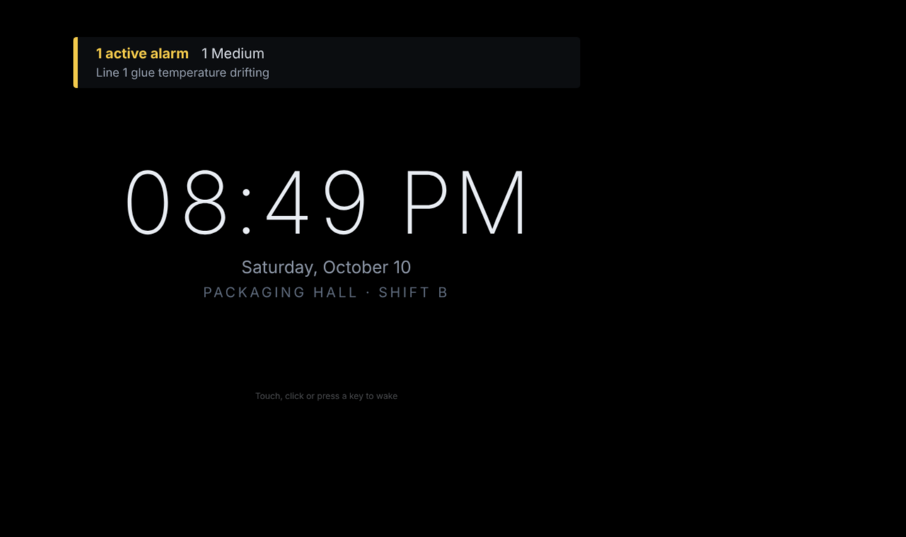

# Mustry Screensaver (working name)

**A screensaver for Perspective that gets out of the way of every alarm.**

An Ignition 8.3 Perspective module for screens nobody is touching. After a
configurable idle time a Perspective page switches to a clock, a starfield
running at line speed, or 3D pipes coloured by your tags. Any touch, key or
mouse movement wakes the page at once, and the tap that wakes it never presses
the button underneath. An alarm wakes it too. It never covers an active
critical alarm.

The serious part is the reason to install it. Vision has
`system.util.getInactivitySeconds()` and `system.security.lockScreen()`.
Perspective has neither. Its built-in inactivity timeout only logs out or closes
the session, and it ignores mouse movement. This module closes the idle part
of that gap. It also moves the pixels on 24/7 displays so the overview doesn't
burn in.

**Who it is for:** Ignition integrators and plant engineers who run Perspective
on control-room walls, shop-floor TVs, line-side panels and shared operator
stations.

## What it does

1. **Real idle detection in the browser.** Pointer (with a jitter threshold),
   touch, key, wheel and tab visibility. Idle state is written to bindable
   props (`output.idle`, `output.idleSince`, ...) and fires `onIdle` /
   `onWake`. The timeout and mode are props, so they can differ per page, role
   or display by binding.
2. **Idle modes.** *Starfield* (speed and colour bound to, say, line rate and
   state), *Pipes* (one pipe per line: colour from its state tag, growth speed
   from its flow), *Clock* (with a line or shift title), *Blank*, and
   *External*, which draws nothing and leaves it to your project (navigate,
   open a popup).
3. **Alarm-aware.** The gateway pushes active alarm counts to every guard. An
   alarm at or above a chosen priority wakes the screen and keeps it awake;
   lower ones pin a banner over the idle mode. An active critical alarm is
   never covered. If the guard cannot hear the gateway, it removes itself.
4. **Burn-in care for 24/7 screens.** Text in the idle modes drifts slowly so
   nothing sits on the same pixels, and the screen can dim on a night schedule
   while idle (lifted by an alarm).

| Clock with a pinned Medium alarm | Starfield at 160 units/min |
|---|---|
|  |  |

**Not a lock.** The guard is a browser overlay, not an access control: anyone
with the browser's developer tools can remove it. For access control use
Perspective's own inactivity timeout and authentication.

## Using it

1. Install the module (free, no licence).
2. Drop one **Idle Guard** (palette: *Mustry Solutions*) into a view in a
   **shared dock**, so it is on every page and survives navigation. It is
   invisible in sessions; in the Designer it shows as a small chip.
3. Set `config.timeoutSec` and `config.mode`, and bind `modes.*` to your tags.
   The [reference](docs/reference.md#props) lists every prop.

## Status

**v0.1, working prototype.** Built and tested on Ignition 8.3.6: 32 unit tests
for the browser logic, 12 for the gateway alarm feed, and a 12-test Playwright
suite against a real gateway (idle and wake, the swallowed waking tap, alarm
wake, banner, Critical never covered, fail-open, the modes).

Planned, not built: an Andon board component, a rotation of your own views, a
privacy lock with re-authentication, page-level pixel orbit, a `[Screensaver]`
tag provider for display fleet health, and a fly-through of your P&ID with the
Mustry HMI Kit. See [what is built](docs/reference.md#what-is-built-v01) and
why some of the spec was deferred.

- [docs/reference.md](docs/reference.md): architecture, props, build, tests
- [docs/market-fit.md](docs/market-fit.md): problem, evidence, competitors,
  pricing, risks, verdict
- [docs/product-spec.md](docs/product-spec.md): user stories, MVP scope,
  architecture on Ignition 8.3, spikes, effort, open questions

Made by Mustry Solutions, Ypres, Belgium. It is a sibling of Mustry Doom and
is planned as a free module.
