# Mustry Screensaver (working name)

**A screensaver for Perspective that gets out of the way of every alarm.**

An Ignition 8.3 Perspective module for screens nobody is touching. After a
configurable idle time a Perspective page switches to 3D pipes, an aurora or a
ring of neon dials, one per production line, coloured and moved by your tags.
Or to something that has nothing to do with the plant: a synthwave sunset, a
lava lamp, a neon tunnel, a particle flow field, the bouncing logo that never
quite hits the corner, Pong between the day and the night shift, or rubber
ducks in hard hats. Any touch, key or
mouse movement wakes the page at once, and the tap that wakes it never presses
the button underneath. An alarm wakes it too. It never covers an active
critical alarm.

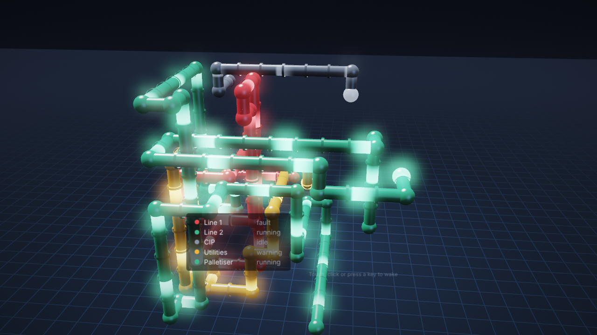

The serious part is the reason to install it. Vision has
`system.util.getInactivitySeconds()` and `system.security.lockScreen()`.
Perspective has neither. Its built-in inactivity timeout only logs out or closes
the session, and it ignores mouse movement. This module closes the idle part
of that gap. It also moves the pixels on 24/7 displays so the overview doesn't
burn in.

**Who it is for:** Ignition integrators and plant engineers who run Perspective
on control-room walls, shop-floor TVs, line-side panels and shared operator
stations.

## What it does

1. **Real idle detection in the browser.** Pointer (with a jitter threshold),
   touch, key, wheel and tab visibility. Idle state is written to bindable
   props (`output.idle`, `output.idleSince`, ...) and fires `onIdle` /
   `onWake`. The timeout and mode are props, so they can differ per page, role
   or display by binding.
2. **Idle modes, driven by your lines.** Bind each line's state and flow to
   tags (`lines[]`) and these modes show them:
   - *Pipes*: glossy 3D pipes grow under a slowly orbiting camera, with light
     pulses running through them at the line's flow. A faulted line glows red
     and throbs.
   - *Aurora*: northern lights over mountains and a still lake, one curtain per
     line in its state colour.
   - *Halo*: neon rings around a clock, a comet per ring orbiting at the line's flow.
   - *Starfield*: a warp flight through a nebula at your line rate.
3. **Showpieces, for screens that just need to look good.** *Synthwave* (a
   retro sunset over a racing neon grid), *Lava* (a screen-sized lava lamp),
   *Tunnel* (a bending neon wormhole), *Flow* (thirty thousand glowing
   particles drifting through a curl-noise field).
4. **Funny ones.** *Bounce* (your name on the bouncing badge; confetti when it
   finally hits a corner), *Pong* (two AIs, day shift against night shift, to
   11), *Ducks* (rubber ducks in hard hats and hi-vis vests reminding everyone
   to hydrate).
5. **Shuffle** rotates through any of them every few minutes. *Clock*,
   *Blank*, and *External* (draws nothing; your project reacts) are there too.

   The animated modes use WebGL2 with bloom and step their quality down on
   weak kiosk hardware. Browsers without WebGL2 get simpler 2D versions.
6. **Alarm-aware, whatever is showing.** The gateway pushes active alarm counts to every guard. An
   alarm at or above a chosen priority wakes the screen and keeps it awake;
   lower ones pin a banner over the idle mode. An active critical alarm is
   never covered. If the guard cannot hear the gateway, it removes itself.
7. **Burn-in and power care for 24/7 screens.** Text in the idle modes drifts
   slowly so nothing sits on the same pixels. At night (22:00-06:00 by default)
   an idle screen goes blank, so nothing is rendered; alarms still wake it. The
   default mode is the plain clock; the animated modes are opt-in.
8. **Reduced motion.** When the browser asks for less motion (or
   `config.reduceMotion` is `always`), the animated modes give way to the clock.

| Aurora: one curtain per line | Halo: Line 1 in fault |
|---|---|
| 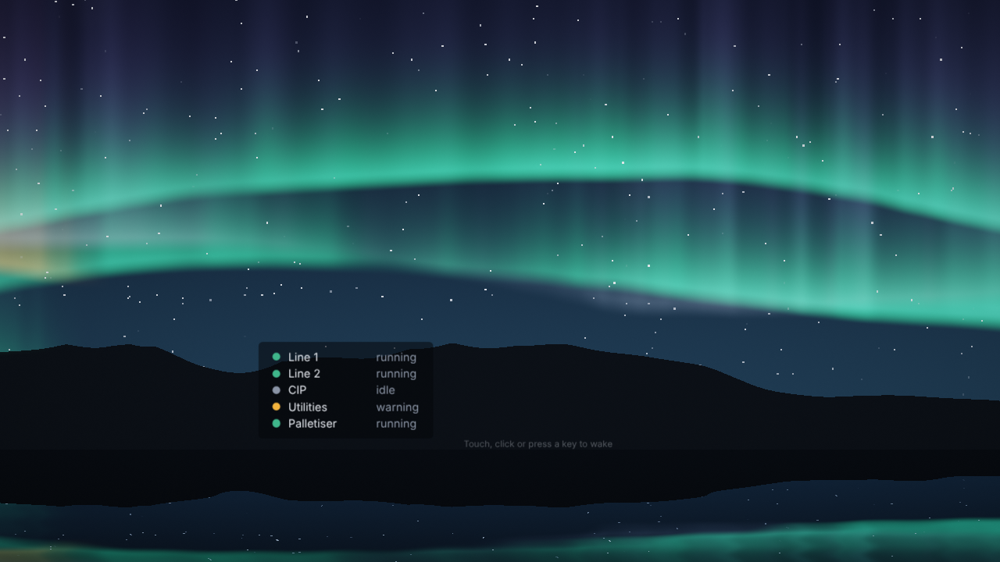 | 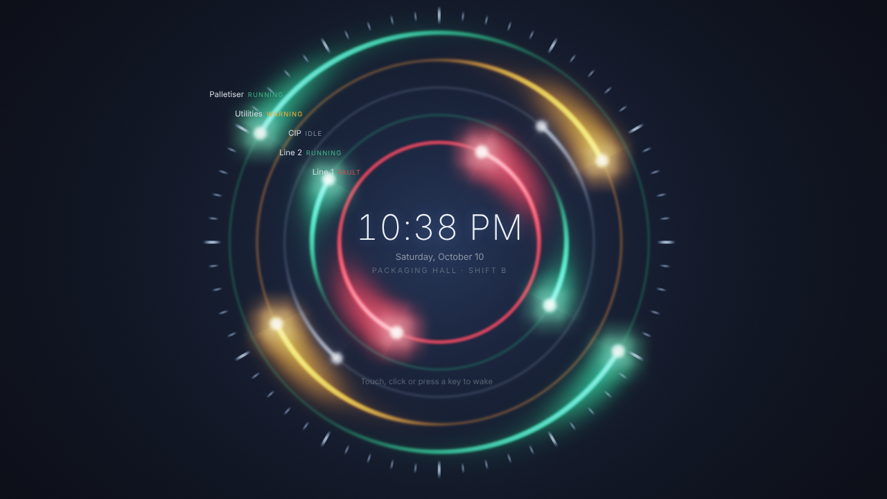 |
| **Synthwave** | **Lava** |
| 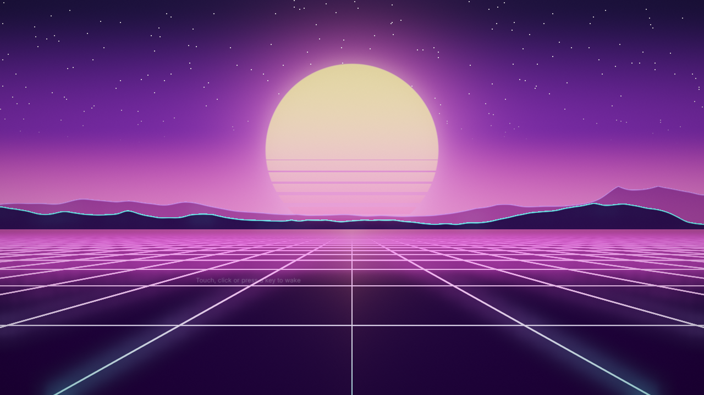 | 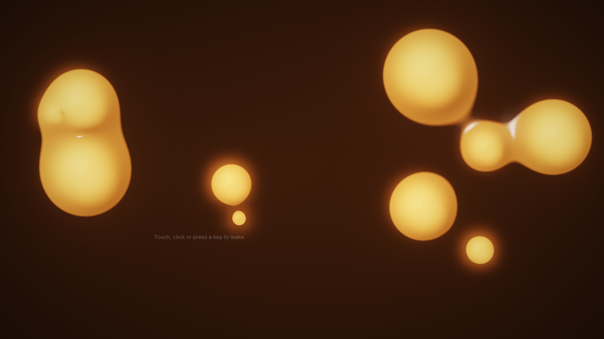 |
| **Tunnel** | **Flow** |
| 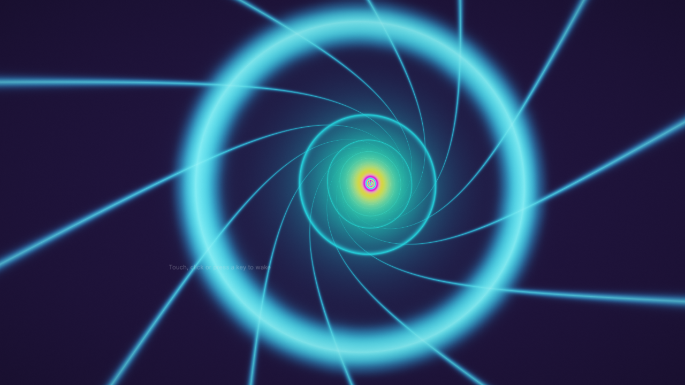 | 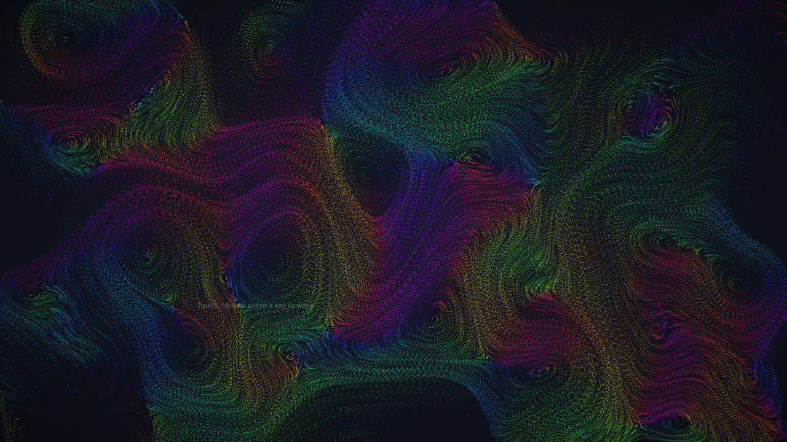 |
| **Ducks** | **Pong: day shift vs night shift** |
| 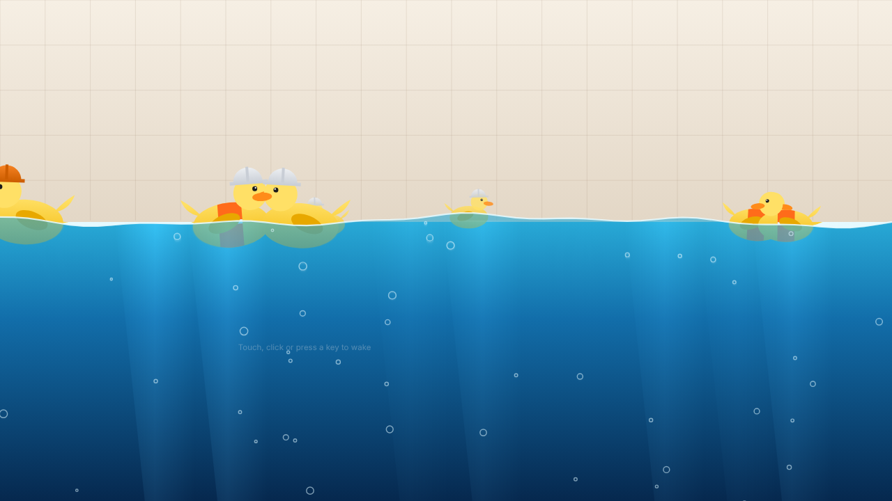 | 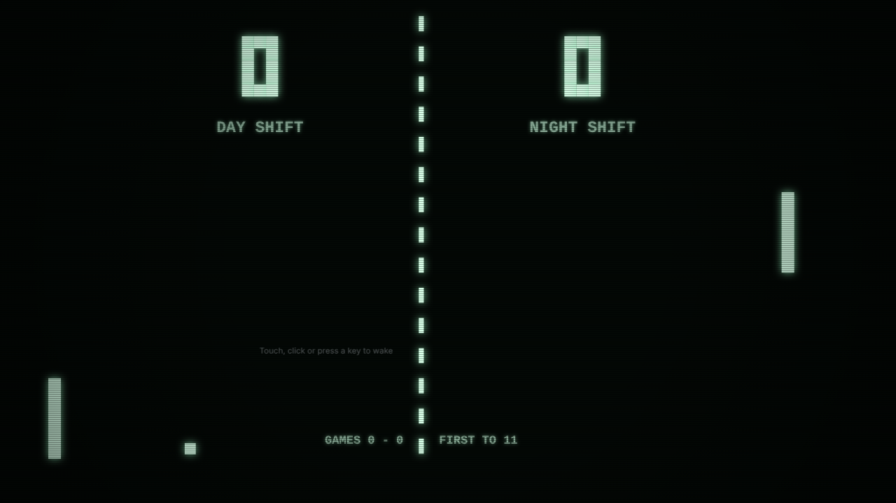 |
| **A Medium alarm pinned over the pipes** | **Starfield at 160 units/min** |
| 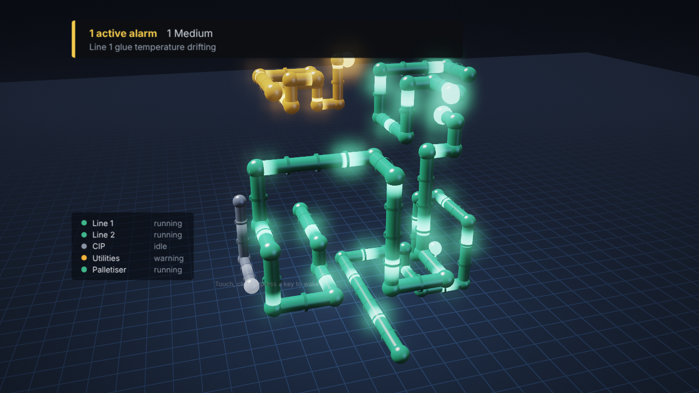 | 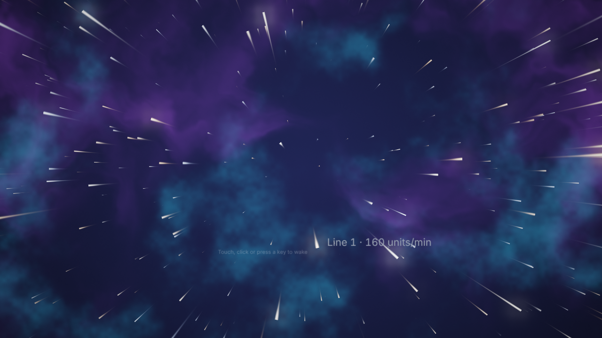 |

**Not a lock.** The guard is a browser overlay, not an access control: anyone
with the browser's developer tools can remove it. For access control use
Perspective's own inactivity timeout and authentication.

## Using it

1. Install the module (free, no licence).
2. Drop one **Idle Guard** (palette: *Mustry Solutions*) into a view in a
   **shared dock**, so it is on every page and survives navigation. It is
   invisible in sessions; in the Designer it shows as a small chip.
3. Set `config.timeoutSec` and `config.mode`, and bind `lines[]` (and
   `modes.*`) to your tags.
   The [reference](docs/reference.md#props) lists every prop.
4. On a public or lobby screen, set `alarm.sources`: every session with a
   guard receives the matching alarms' labels, whoever is logged in. See
   [who sees the alarms](docs/reference.md#who-sees-the-alarms).

## Status

**v0.1, working prototype.** Built and tested on Ignition 8.3.6: unit tests
for the browser logic and the gateway alarm feed, and a Playwright suite
against a real gateway: idle and wake, the swallowed waking tap, alarm wake,
banner, Critical never covered, fail-open, every mode drawing on its renderer,
every GL mode falling back to 2D without WebGL2, and shuffle swapping modes.
Not yet measured on real kiosk hardware (a Raspberry Pi, an old NUC): the
quality governor is there for them, but nobody has watched it run on one.

Planned, not built: an Andon board component, a rotation of your own views, a
privacy lock with re-authentication, page-level pixel orbit, a `[Screensaver]`
tag provider for display fleet health, and a fly-through of your P&ID with the
Mustry HMI Kit. See [what is built](docs/reference.md#what-is-built-v01) and
why some of the spec was deferred.

- [docs/reference.md](docs/reference.md): architecture, props, build, tests
- [docs/market-fit.md](docs/market-fit.md): problem, evidence, competitors,
  pricing, risks, verdict
- [docs/product-spec.md](docs/product-spec.md): user stories, MVP scope,
  architecture on Ignition 8.3, spikes, effort, open questions

Made by Mustry Solutions, Ypres, Belgium. It is a sibling of Mustry Doom and
is planned as a free module.
